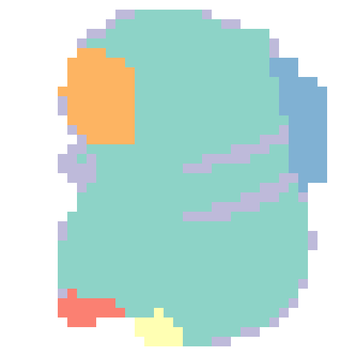
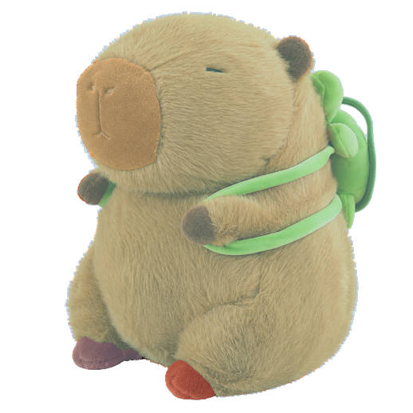

# DiagGen / Genesis 批次執行進度

狀態：**執行中**  
模型：`gpt-6-luna`，reasoning `max`  
更新：2026-10-22T17:47:37+08:00（Asia/Taipei）

共 9 件：等待 2、執行中 4、完成 2、失敗 1、取消 0。

GPU 可用記憶體門檻：24576 MiB；最多同時 4 件；排程每 15 秒檢查。  
允許與既有運算共用 GPU：是。

只在排程狀態、階段、revision 或預覽成果改變時更新。等待期間不重複提交。

診斷健康提示是唯讀觀察，不會解除鎖、重排或改寫成功／失敗。久未更新也可能是較長的模型推理，需配合紀錄判讀。

| 物件 | 排程狀態 | Runtime | Revision | 顯存門檻 | 已完成階段 | 健康提示 |
|---|---|---|---|---|---|---|
| baseball_cap | running | seeded | revision_0000 | 24576 MiB | 6/9 | 未偵測到上述異常（非成功保證） |
| kitchen_tongs | running | running | revision_0001 | 24576 MiB | 2/9 | 未偵測到上述異常（非成功保證） |
| sneaker | running | running | revision_0001 | 24576 MiB | 1/9 | 未偵測到上述異常（非成功保證） |
| usb_hub | running | running | revision_0000 | 24576 MiB | 8/9 | 未偵測到上述異常（非成功保證） |
| sloth | success | success | revision_0000 | 24576 MiB | 9/9 | 未偵測到上述異常（非成功保證） |
| sauce_keeper | queued | not_initialized | 尚未初始化 | 24576 MiB | 0/9 | 未偵測到上述異常（非成功保證） |
| dragon | queued | seeded | revision_0000 | 24576 MiB | 0/9 | 未偵測到上述異常（非成功保證） |
| capybara_plush_toy | failed | seeded | revision_0000 | 49152 MiB | 2/9 | 未偵測到上述異常（非成功保證） |
| curling_iron | success | success | revision_0000 | 24576 MiB | 9/9 | 未偵測到上述異常（非成功保證） |

## baseball_cap

Run：`genesis_baseball_cap_20261022_fresh3`；執行中。

| 階段 | 狀態 |
|---|---|
| 圖片清理 | success |
| SAM3 分割 | success |
| OmniPart 幾何生成 | success |
| 材料推估 | success |
| 材料參數配置 | success |
| 體積網格處理 | success |
| Genesis 物理診斷 | running |
| 貼圖生成 | pending |
| 最終匯出 | pending |

Genesis 診斷 episode 數：1。

## kitchen_tongs

Run：`genesis_kitchen_tongs_20261022_segmentation_retry1`；執行中。

| 階段 | 狀態 |
|---|---|
| 圖片清理 | pending |
| SAM3 分割 | success |
| OmniPart 幾何生成 | pending |
| 材料推估 | pending |
| 材料參數配置 | pending |
| 體積網格處理 | pending |
| Genesis 物理診斷 | pending |
| 貼圖生成 | pending |
| 最終匯出 | pending |

Genesis 診斷 episode 數：0。

## sneaker

Run：`genesis_sneaker_20261022_clean_diagnostics1`；執行中。

| 階段 | 狀態 |
|---|---|
| 圖片清理 | pending |
| SAM3 分割 | pending |
| OmniPart 幾何生成 | pending |
| 材料推估 | pending |
| 材料參數配置 | pending |
| 體積網格處理 | pending |
| Genesis 物理診斷 | pending |
| 貼圖生成 | pending |
| 最終匯出 | pending |

Genesis 診斷 episode 數：0。

## usb_hub

Run：`genesis_usb_hub_20261022_clean_diagnostics3`；執行中。

| 階段 | 狀態 |
|---|---|
| 圖片清理 | success |
| SAM3 分割 | success |
| OmniPart 幾何生成 | success |
| 材料推估 | success |
| 材料參數配置 | success |
| 體積網格處理 | success |
| Genesis 物理診斷 | success |
| 貼圖生成 | success |
| 最終匯出 | pending |

Genesis 診斷 episode 數：2。

[usb_hub_episode_001_triptych_video](media/usb_hub_episode_001_triptych_video.mp4)

[usb_hub_episode_002_triptych_video](media/usb_hub_episode_002_triptych_video.mp4)

## sloth

Run：`genesis_sloth_20261022_clean_diagnostics3`；完成。

| 階段 | 狀態 |
|---|---|
| 圖片清理 | success |
| SAM3 分割 | success |
| OmniPart 幾何生成 | success |
| 材料推估 | success |
| 材料參數配置 | success |
| 體積網格處理 | success |
| Genesis 物理診斷 | success |
| 貼圖生成 | success |
| 最終匯出 | success |

Genesis 診斷 episode 數：2。

[sloth_episode_001_triptych_video](media/sloth_episode_001_triptych_video.mp4)

[sloth_episode_002_triptych_video](media/sloth_episode_002_triptych_video.mp4)

## sauce_keeper

Run：`genesis_sauce_keeper_20261022_clean_diagnostics2`；等待空閒 GPU。

| 階段 | 狀態 |
|---|---|
| 圖片清理 | pending |
| SAM3 分割 | pending |
| OmniPart 幾何生成 | pending |
| 材料推估 | pending |
| 材料參數配置 | pending |
| 體積網格處理 | pending |
| Genesis 物理診斷 | pending |
| 貼圖生成 | pending |
| 最終匯出 | pending |

Genesis 診斷 episode 數：0。

## dragon

Run：`genesis_dragon_20261021`；等待空閒 GPU。

| 階段 | 狀態 |
|---|---|
| 圖片清理 | pending |
| SAM3 分割 | pending |
| OmniPart 幾何生成 | pending |
| 材料推估 | pending |
| 材料參數配置 | pending |
| 體積網格處理 | pending |
| Genesis 物理診斷 | pending |
| 貼圖生成 | pending |
| 最終匯出 | pending |

Genesis 診斷 episode 數：0。

## capybara_plush_toy

Run：`genesis_capybara_plush_toy_20261022_native_retry3`；執行失敗。

| 階段 | 狀態 |
|---|---|
| 圖片清理 | success |
| SAM3 分割 | success |
| OmniPart 幾何生成 | failed |
| 材料推估 | pending |
| 材料參數配置 | pending |
| 體積網格處理 | pending |
| Genesis 物理診斷 | pending |
| 貼圖生成 | pending |
| 最終匯出 | pending |

Genesis 診斷 episode 數：0。

## curling_iron

Run：`genesis_curling_iron_20261021_exr_retry1`；完成。

| 階段 | 狀態 |
|---|---|
| 圖片清理 | success |
| SAM3 分割 | success |
| OmniPart 幾何生成 | success |
| 材料推估 | success |
| 材料參數配置 | success |
| 體積網格處理 | success |
| Genesis 物理診斷 | success |
| 貼圖生成 | success |
| 最終匯出 | success |

Genesis 診斷 episode 數：2。

[curling_iron_episode_001_triptych_video](media/curling_iron_episode_001_triptych_video.mp4)

[curling_iron_episode_002_triptych_video](media/curling_iron_episode_002_triptych_video.mp4)

完整執行紀錄、GPU 識別資訊與失敗細節保留在伺服器。
